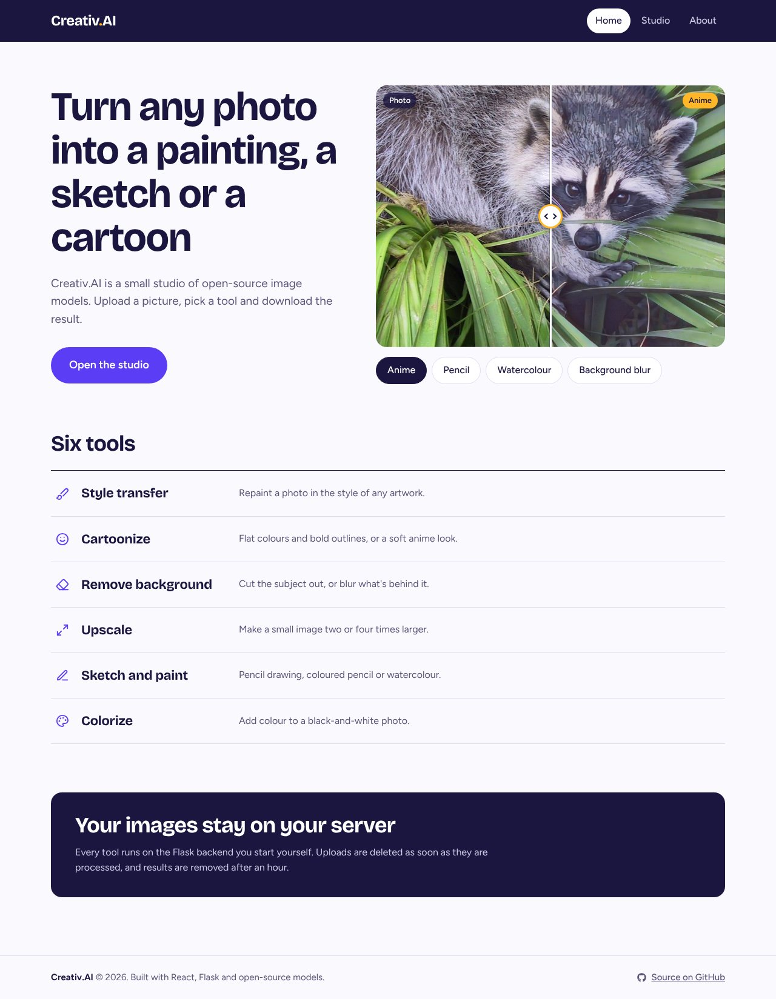
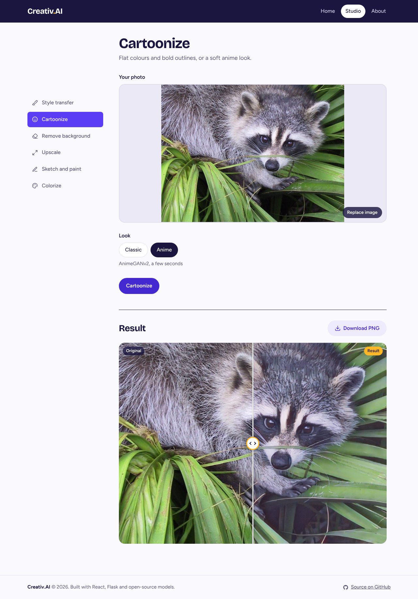
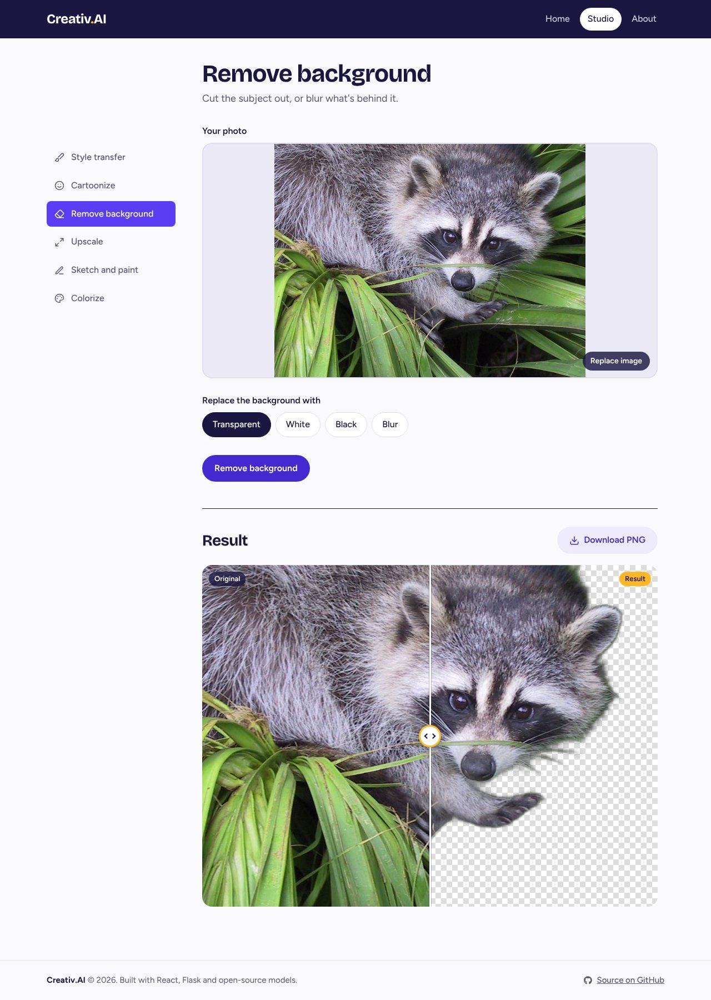

# Creativ.AI

A React and Flask app that turns photos into paintings, sketches and cartoons with open-source models.

## Tools

| Tool | What it does | Runs on |
|---|---|---|
| Style transfer | Repaints a photo in the style of another image | Magenta arbitrary image stylization (TensorFlow Hub) |
| Cartoonize | Classic outline cartoon, or an anime look | OpenCV filters, AnimeGANv2 (ONNX) |
| Remove background | Transparent, white, black or blurred background | rembg (U²-Net) |
| Upscale | 2× or 4× larger | FSRCNN (fast) or EDSR (sharp) |
| Sketch and paint | Pencil, coloured pencil, watercolour | OpenCV filters |
| Colorize | Adds colour to black-and-white photos | Colorful Image Colorization (ONNX) |

Model weights are downloaded into `backend/models/` the first time each tool is used.
AnimeGANv2 is licensed for non-commercial use only.

## Run it

Backend (Python 3.10 or newer):

```bash
cd backend
python -m venv venv && source venv/bin/activate   # Windows: venv\Scripts\activate
pip install -r requirements.txt
python app.py
```

Frontend, in a second terminal:

```bash
cd stylize_react_app
npm install
npm start
```

The frontend expects the backend at `http://127.0.0.1:5000`. To use another address, set
`REACT_APP_API_URL` in `stylize_react_app/.env`.

## Screenshots

Home page, with a live before/after preview of the effects:



Cartoonize with the anime look:



Remove background with a transparent result:


